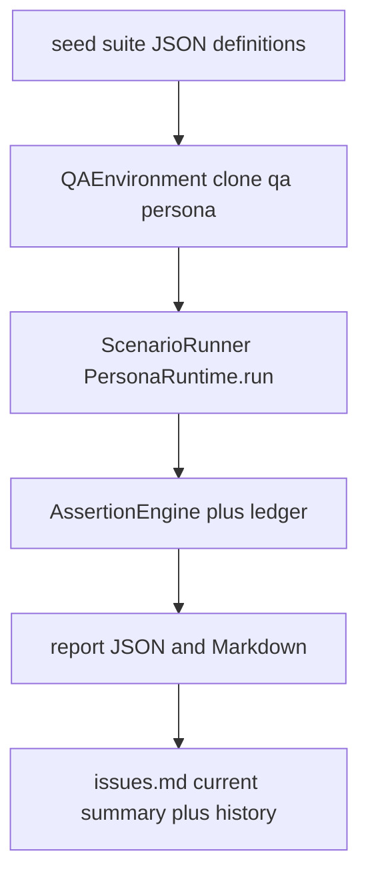

# Persona consistency QA system

## Status

Implemented: Mongo-backed QA suites, isolated `qa-*` environment, scenario runner
on the real LangGraph pipeline, deterministic assertion engine + consistency
ledger, Markdown/JSON reports with previous-run comparison, CLI
(`python -m persona_runtime.qa`), 150 seeded cases (PROFILE…PERSIST), and
pytest coverage. Live LLM judging remains opt-in via `QA_LLM=live`. An independent
2026-10-20 post-fix pass ran Track A (deterministic 100% eligible) and a
prioritized live OpenAI track; readiness is **not ready** — see Test results.

Prior engagement / timeline / answer-grounding work remains the factual authority
for meals, location, transport, and schedule.

## Architecture

Package: [`persona_runtime/qa/`](persona_runtime/qa/)

| Module | Role |
|--------|------|
| `fixtures/definitions.py` | All 150 case definitions + JSON export |
| `seed.py` / `repository.py` | Suite/case/step/run/issue persistence |
| `environment.py` | Clone identity, clock, reopen, rebuild, safe cleanup |
| `runner.py` | Multi-step scenarios, proactive policy probes |
| `assertions.py` | Deterministic checks; LLM judge only in live mode |
| `ledger.py` | Claim ledger; valid timeline transitions ≠ contradictions |
| `report.py` / `cli.py` | Reports + `seed\|run\|compare` CLI |
| `issues_md.py` | Root `issues.md` summary; filtered runs append history only |
| `fake_llm.py` | Offline stub; speaks answer plan and clock, not the whole prompt |

Collections (via [`persona_runtime/db/__init__.py`](persona_runtime/db/__init__.py)):
`PersonaTestSuites`, `PersonaTestCases`, `PersonaTestSteps`, `PersonaTestRuns`,
`PersonaTestResults`, `PersonaTestStepResults`, `PersonaTestIssues`.

## Isolation rules

- PersonaState / TimelineEvents are persona-scoped → every scenario clones into `qa-*`.
- Cleanup deletes only `qa-` prefixes; refuses `sarah_taylor_001` / `local-user`.
- DB must be mongomock or name containing `qa` / `test` (or `QA_DB_NAME`).

## Clock

`MemoryRetriever` recency scoring uses injectable `utcnow()` + `ensure_utc` so
frozen-clock tests stay deterministic (timezone-safe vs mongomock naive datetimes).

## Docs

See [docs/persona_qa.md](docs/persona_qa.md) for how to add a case, modes,
severity, blocked-vs-fail policy, and limitations.

## Test results

### Independent post-fix QA — 2026-10-20

Preflight: default `DB_NAME` is `Sarah` (unsafe). All writes used isolated mongomock named `SarahQA` after a real-Mongo CLI run proved ~45s/case on index+clone. Runtime targets were `qa-*` only. Clone source `sarah_taylor_001` was not a test target. `key_state=present`; model `gpt-4o-mini`; timezone `Europe/London`. Secrets were not printed.

Harness-only changes (not product fixes): HUMAN-016/017/018 in `persona_runtime/qa/fixtures/definitions.py`; `scripts/qa_track_a.py`, `scripts/qa_live_track.py`, `scripts/qa_benchmark_report.py`. `--trials` was not “fixed” (report aggregators collapse by test key). Three HUMAN live runs were used instead.

Commands and exit codes:

- `python -m persona_runtime.qa seed --write-json` with `QA_DB_NAME=SarahQA` — exit 0, 153 cases.
- Real-Mongo `python -m persona_runtime.qa run` — aborted (too slow); not treated as a result.
- `python scripts/qa_track_a.py` — exit 0; run `d79303e5-6e04-450a-bf92-2394488e42ad`; **153 executed, 111 passed, 0 failed, 42 blocked**. Eligible deterministic pass rate 100% (111/111). Extra 3 blocks are HUMAN-016–018 live assertions.
- `.venv311/Scripts/python.exe -m pytest -q --tb=line` — **184 passed, 2 skipped** (`RUN_LLM_EVAL` unset). Exit 0.
- `python scripts/qa_live_track.py --set B1` — exit 1; `cb71a460`; 34/4/1.
- `--set B2` — exit 1; `d44bb44d`; 25/4/0.
- `--set B3 --trial 1|2|3` — exit 1; `70dadc5d` 13/5/0; `a9a6a5e3` 14/4/0; `33f7ffaa` 15/3/0.

Live combined rows: 101 passed / 20 failed / 1 blocked. Eligible live pass rate 83.5% (101/121). Same-model judge. Naturalness estimate 3.61/5 (n=89 scored replies; experimental 72.2/100). **Not a validated human-likeness score.**

Prior 21 failures: all passed on Track A. Live still failed MEM-005, MEM-008, STATE-015. New live issues: memory retrieve/use on long/multi-fact turns (MEM-003, HUMAN-018); STATE-015 Leeds override ignored by the live model; HUMAN-011 boundary; flaky/unreliable `topic_relevance` (HUMAN-001).

Readiness: **not ready** for production or wider beta. Deterministic pipeline is promising; live model is not validated.

Deliverables: `qa_reports/full_qa_report.md`, `qa_reports/benchmark_report.md`, `qa_reports/human_review_pack.md`, `qa_reports/benchmark_results.csv`, `qa_reports/<run_id>.json`, `issues.md`.

### Earlier 2026-10-19 deterministic cycle

Executed 2026-10-19 on mongomock with `DeterministicQALLM` (no OpenAI). Database name `SarahQA`. Production persona `sarah_taylor_001` was not used.

- `.venv311/Scripts/python.exe -m pytest -q --tb=line`: **184 passed, 2 skipped** (opt-in `RUN_LLM_EVAL`).
- Full persona suite run `711fea9b-d185-4a3b-ac73-a051f4518309`: **150 executed, 111 passed, 0 failed, 39 blocked, 0 skipped**. Pass rate among non-blocked tests: 100%. Report: `qa_reports/711fea9b-d185-4a3b-ac73-a051f4518309.json`. Issue log: `issues.md`.
- Baseline full run `dea14aee-aabc-4601-b522-566e99b6b98e` was **90 passed, 21 failed, 39 blocked**. All 21 of those keys passed on `711fea9b`. The 39 blocked cases are still the live tone/topic checks.
- Earlier full run `f02871dd-b857-42bc-b91f-e428fcf49dc7` (74/37/39) was inflated by a shared stub `invalid_json` mode left on after `FORMAT-010`. The runner resets that mode per case. Re-test `d6e9935f-bbd1-4d5b-b910-19515a20d16f` matched the baseline (90/21/39).

### Confirmed causes of the 21 failures

Hometown canon stays **Sheffield** (`PERSONA_FACT_HOMETOWN`). Leeds is only the STATE-015 residence override and the university fact.

1. Multi-part questions became one slot. `_split_question_chunks` only split newlines or two or more `?`, and `classify_slot` kept the first regex hit, so occupation, employer, office, city, and zodiac were not all answered. Clauses now split on commas and `and` when the pieces classify to different slots, and each distinct slot is grounded. Files: `persona_runtime/graph/questions.py`, `persona_runtime/graph/grounding.py`.
2. Answer planning read `SEED_CANONICAL_FACTS` only, so a Mongo `correct_canonical_fact` on the `qa-` clone never reached the reply. `retrieve_facts` now prefers `all_canonical_facts` from the current persona. Hometown phrasing maps to Sheffield; residence phrasing (`where do you live`, `where are you based`, `which city`) maps to `PERSONA_FACT_LIVES_IN`. Office answers include the configured name and address. Files: `persona_runtime/graph/grounding.py`, `persona_runtime/graph/nodes.py`.
3. User-fact questions missed the memory slot or hit Sarah’s preferences. The stub answered names with hardcoded Alex and otherwise “Yeah, fair enough.” Extraction also scanned the assistant echo, so a tea reply on the recall turn superseded a coffee correction. First-person asks now select active user memories by facet; corrections supersede; equal-confidence non-corrections do not replace a different object; the stub speaks the answer plan and reads only `user_message`. Files: `persona_runtime/graph/questions.py`, `persona_runtime/graph/grounding.py`, `persona_runtime/graph/nodes.py`, `persona_runtime/memory/consolidation.py`, `persona_runtime/qa/fake_llm.py`.
4. False premises (“You live in London, right?”, “So you drive your own car every day?”) never entered factual slots, so the stub agreed. They now classify as identity or transport and the plan states Manchester and public transport / no personal car. Files: `persona_runtime/graph/questions.py`, `persona_runtime/graph/grounding.py`, `persona_runtime/graph/nodes.py`.
5. “Where are you based?” was both `permanent_identity` and `location_now`. Disclosure then suppressed `PERSONA_FACT_LIVES_IN`, validation repaired the Manchester answer away, and the multi-target fallback spoke occupation and “at the office at my desk.” Residence and hometown asks stay allowed, and a non-empty answer plan is spoken before the world-state fallback. A planned non-Manchester city (the Leeds override) is not rejected as a contradiction. Files: `persona_runtime/graph/fact_tracker.py`, `persona_runtime/graph/nodes.py`, `persona_runtime/graph/validator.py`.

Regression coverage is in `tests/test_answer_grounding.py` (compound slots, hometown vs city, office name and address, Leeds override, false premises, user-memory facets, stub plan speech) and `tests/test_memory.py` (`test_semantic_correction`). The full suite is the end-to-end check, including recall after later turns.

## Decisions

- Expected profile values are fact refs resolved from the cloned persona / clock /
  world — not hard-coded fiction in the runner.
- Memory persisted / retrieved / used-in-reply are separate assertions.
- Live tone/topic checks are blocked offline (never silent pass); not release blockers.
- Proactive “quiet hours” maps to sleeping / low-availability gates (no named setting).
- Reopen conversation = set status `closed` so `get_or_create` issues a new id.
- Backend restart = new `PersonaRuntime` on the same database.
- `persona_runtime.graph` loads `PersonaRuntime` lazily so `python -m persona_runtime.qa` does not cycle through conversation engagement.
- Stub failure modes are per case. Offline replies follow the answer plan and clock block.
- Hometown stays Sheffield. A residence correction such as STATE-015 is read from the cloned persona’s canonical facts on the next turn, not from the seed list.
- The consistency ledger can record successive different facts in one multi-part reply (city, then job) under the same `persona.fact` attribute. Those cases still passed; the ledger lines in `issues.md` are not open product failures.

## Remaining / known gaps

- Live STATE-015 still answers Manchester after a Leeds residence override.
- Live memory: persist can succeed while retrieve/use fail (MEM-003/005/008, HUMAN-018).
- Same-model `topic_relevance` judge is poorly calibrated (HUMAN-001).
- `--trials` CLI flag still stores only one trial; do not use it for variability.
- Full 153-case live suite was not run (TIME/PERSIST live omitted). Do not imply they were live-tested.
- Optional QA HTTP API left disabled (CLI is the supported entry).
- Django UI bubble merge/split was not verified against production chat.
- `tests/test_naturalness_eval.py` must not be enabled against `sarah_taylor_001`.
- Relative-date and engagement limitations from the prior engagement work still apply.

## Next steps

- Human-calibrate the 1–5 rubric using `qa_reports/human_review_pack.md`.
- Investigate live STATE-015 override path and live memory retrieval vs persist.
- Keep CI on deterministic Track A; treat live as a separate non-gating or separately gated job.
- Soften opening when outbound resume fires mid-activity (prior engagement backlog).
